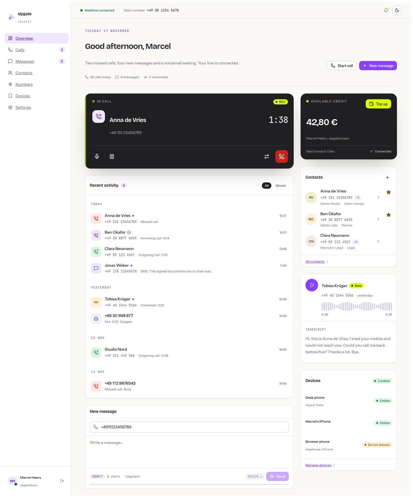
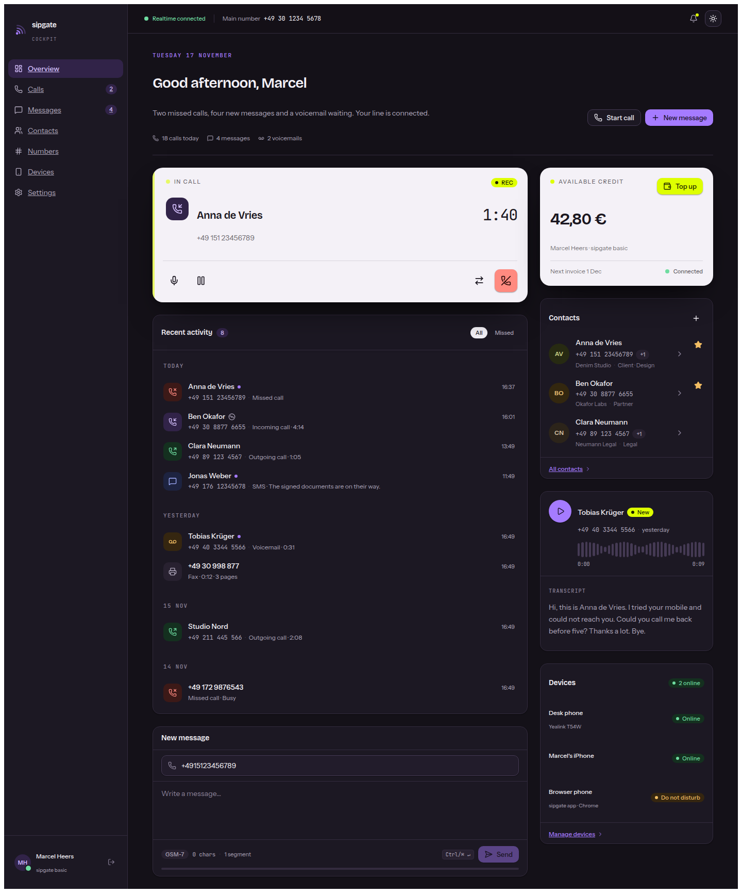

# sipgate UI components

**A considered Vue 3 component library for sipgate applications.** Live calls, call history,
SMS threads, contacts, devices, numbers and voicemail — one visual language, accessible
defaults, and the telephony details generic UI kits always miss.

[](./LICENSE)
[](https://vuejs.org)
[](https://tailwindcss.com)
[](https://storybook.js.org)
[](./CONTRIBUTING.md)



<details>
<summary>Dark theme</summary>



</details>

> **Status:** `0.1.0`, pre-1.0. Component APIs are stable enough to build on, but minor
> releases may still adjust props. Every change is documented in the
> [changelog](./CHANGELOG.md).

## Why this library exists

sipgate's API exposes the real texture of telephony: inbound, outbound and missed calls,
GSM-7 and UCS-2 messages, faxes, devices that are online, busy or in do-not-disturb, and
numbers that need to be readable in a fraction of a second. Every application rebuilds the
same screens — and usually arrives at a different answer for how to format a number or count
an SMS segment.

This library centralises the answers:

- **Domain correct.** German-first phone formatting with international fallbacks; GSM-7
  extension characters counted twice; UCS-2 limits; call direction, outcome, hold and
  recording states; device presence; account credit.
- **Accessible by construction.** Visible focus rings, real labels, semantic live regions,
  keyboard paths for tabs, dialogs and the voicemail scrubber, and reduced-motion support.
- **Quiet, distinctive design.** Warm paper, ink, sipgate violet for action, and a single
  acid-lime signal reserved for genuinely live audio.
- **Yours to theme.** Every theme value is a prefixed `--sg-*` token. Light and dark themes, a
  scoped reset, and no collision with an existing shadcn/Tailwind theme.
- **Documented.** Storybook pages with props, states, accessibility notes and a complete
  cockpit composition.
- **Runnable example.** `examples/cockpit` is a realistic dashboard, not a kitchen sink.

## Quick start

```bash
pnpm add @mheers/sipgate-ui-components
```

`vue ^3.5` is a peer dependency. Import the compiled stylesheet once — the host app does not
need Tailwind or any build configuration:

```ts
// main.ts
import '@mheers/sipgate-ui-components/style.css';
```

Wrap the area that uses the library in `.sg-root`. It provides the design tokens, the font
stack and a minimal reset scoped to that subtree:

```vue
<script setup lang="ts">
import { ref } from 'vue';
import {
  ActiveCallCard,
  CallHistoryList,
  SmsComposer,
  type HistoryEntry,
} from '@mheers/sipgate-ui-components';

const muted = ref(false);
const held = ref(false);
const startedAt = new Date();
const message = ref('');
const recipient = ref('+4915123456789');
const history = ref<HistoryEntry[]>([]);

function hangUp() {
  // call your API client
}

function openEntry(entry: HistoryEntry) {
  // open a detail view
}

function sendSms(payload: { message: string; recipient: string }) {
  // send through sipgate
}
</script>

<template>
  <div class="sg-root min-h-screen bg-sg-background p-6 text-sg-foreground">
    <ActiveCallCard
      name="Anna de Vries"
      number="+49 151 23456789"
      :started-at="startedAt"
      :state="held ? 'held' : 'active'"
      :muted="muted"
      :recording="true"
      @toggle-mute="muted = !muted"
      @toggle-hold="held = !held"
      @hangup="hangUp"
    />

    <CallHistoryList :entries="history" @select="openEntry" />

    <SmsComposer v-model="message" v-model:recipient="recipient" @send="sendSms" />
  </div>
</template>
```

Add `sg-dark` to `<html>` for the dark theme, so dialogs and tooltips rendered in a portal
inherit it too. A wrapper-level `sg-dark` still themes inline components, but portalled
overlays live under `<body>` and only see the document-level theme:

```html
<html class="sg-dark">
  <body>
    <div class="sg-root"><!-- dark sipgate UI --></div>
  </body>
</html>
```

Until the first npm release, install from a local checkout:

```bash
pnpm install && pnpm build
pnpm pack
# in your app
pnpm add ../sipgate-ui-components/mheers-sipgate-ui-components-0.1.0.tgz
```

## Components

All components live in [`src/components`](./src/components). Every top-level component has a
Storybook page; compound subcomponents such as `CardHeader` and `DialogFooter` are documented
with their parent.

### Primitives

| Component                                          | What it does                                                                             |
| -------------------------------------------------- | ---------------------------------------------------------------------------------------- |
| [`Button`](./src/components/ui/Button.vue)         | Ten intents including inverse variants for dark call surfaces, six sizes, loading state. |
| [`Input`](./src/components/ui/Input.vue)           | Single-line field with leading/trailing slots and invalid/disabled states.               |
| [`Textarea`](./src/components/ui/Textarea.vue)     | Multi-line text with optional auto-resize.                                               |
| [`Label`](./src/components/ui/Label.vue)           | Compact form label with a required marker.                                               |
| [`Badge`](./src/components/ui/Badge.vue)           | Pill label in eight tones, optional presence dot.                                        |
| [`Card`](./src/components/ui/Card.vue)             | Surface plus `CardHeader`, `CardTitle`, `CardDescription`, `CardContent`, `CardFooter`.  |
| [`Avatar`](./src/components/ui/Avatar.vue)         | Stable initials, five sizes, presence dot, image fallback.                               |
| [`Tabs`](./src/components/ui/Tabs.vue)             | reka-ui segmented control with roving focus.                                             |
| [`Switch`](./src/components/ui/Switch.vue)         | Labelled binary setting with description.                                                |
| [`Tooltip`](./src/components/ui/Tooltip.vue)       | Hover/focus explanation with a portal.                                                   |
| [`Dialog`](./src/components/ui/Dialog.vue)         | Focus-trapped modal with title, description, footer and close button.                    |
| [`Spinner`](./src/components/ui/Spinner.vue)       | Indeterminate progress with a hidden status label.                                       |
| [`Skeleton`](./src/components/ui/Skeleton.vue)     | Shimmering placeholder that honours reduced motion.                                      |
| [`Separator`](./src/components/ui/Separator.vue)   | Horizontal or vertical hairline.                                                         |
| [`EmptyState`](./src/components/ui/EmptyState.vue) | Dotted-paper empty state with an action slot.                                            |
| [`CopyButton`](./src/components/ui/CopyButton.vue) | Copy with check state and a live-region announcement.                                    |
| [`PageHeader`](./src/components/ui/PageHeader.vue) | Eyebrow, display title, description, actions and metadata.                               |

### sipgate domain

| Component                                                               | What it does                                                              |
| ----------------------------------------------------------------------- | ------------------------------------------------------------------------- |
| [`PhoneNumber`](./src/components/sipgate/PhoneNumber.vue)               | Formats and links numbers; optional copy action; `tel:` safe.             |
| [`CommunicationBadge`](./src/components/sipgate/CommunicationBadge.vue) | Call/SMS/fax/voicemail plus direction, icon and label.                    |
| [`CommunicationIcon`](./src/components/sipgate/CommunicationIcon.vue)   | The same vocabulary as a compact icon tile.                               |
| [`CallTimer`](./src/components/sipgate/CallTimer.vue)                   | Live call clock with a stable screen-reader sentence.                     |
| [`ActiveCallCard`](./src/components/sipgate/ActiveCallCard.vue)         | Ringing/active/held call stage with answer, mute, hold and hangup.        |
| [`CallHistoryItem`](./src/components/sipgate/CallHistoryItem.vue)       | One history row with outcome, duration, time and recording marker.        |
| [`CallHistoryList`](./src/components/sipgate/CallHistoryList.vue)       | Grouped by day, loading and empty states, custom row slot.                |
| [`SmsComposer`](./src/components/sipgate/SmsComposer.vue)               | GSM-7/UCS-2 detection, billable segments, limit blocking, Ctrl/⌘+Enter.   |
| [`SmsBubble`](./src/components/sipgate/SmsBubble.vue)                   | One message with timestamp and delivery ticks.                            |
| [`SmsThread`](./src/components/sipgate/SmsThread.vue)                   | Conversation with day separators, typing indicator and smart auto-scroll. |
| [`VoicemailPlayer`](./src/components/sipgate/VoicemailPlayer.vue)       | Waveform scrubber, transcript, unlistened state.                          |
| [`ContactListItem`](./src/components/sipgate/ContactListItem.vue)       | Contact row with primary number, tags and favourite pinning.              |
| [`DeviceCard`](./src/components/sipgate/DeviceCard.vue)                 | Endpoint kind, model, presence and assigned numbers.                      |
| [`DeviceStatusBadge`](./src/components/sipgate/DeviceStatusBadge.vue)   | Online, offline, busy, do-not-disturb, ringing.                           |
| [`AccountBalance`](./src/components/sipgate/AccountBalance.vue)         | Credit on the inverse surface with low-balance warning.                   |
| [`ConnectionStatus`](./src/components/sipgate/ConnectionStatus.vue)     | Realtime transport state as a polite live region.                         |

### Composables and utilities

| Export                                                           | What it does                                                             |
| ---------------------------------------------------------------- | ------------------------------------------------------------------------ |
| [`useCallDuration`](./src/composables/useCallDuration.ts)        | Reactive seconds since call start; SSR-safe and tick cleanup.            |
| [`useClipboard`](./src/composables/useClipboard.ts)              | Clipboard API with a legacy fallback and transient `copied` state.       |
| [`formatPhoneNumber`](./src/lib/phone.ts)                        | German area-code intelligence, mobile prefixes, international fallbacks. |
| [`parsePhoneNumber`](./src/lib/phone.ts)                         | E.164 parsing from `+49`, `0049`, national and messy input.              |
| [`telHref`](./src/lib/phone.ts)                                  | Safe `tel:` links.                                                       |
| [`analyzeSms`](./src/lib/sms.ts)                                 | GSM-7 vs UCS-2, septet counting, billable segments.                      |
| [`formatDuration` / `formatDurationWords`](./src/lib/format.ts)  | Clock (`1:02:05`) and localised human durations.                         |
| [`formatRelativeTime` / `formatDayHeading`](./src/lib/format.ts) | “5 minutes ago”, “Today”, “Yesterday”.                                   |
| [`formatCurrency`](./src/lib/format.ts)                          | Locale-aware money for account credit.                                   |
| [`getInitials`](./src/lib/format.ts)                             | Deterministic initials from names, emails and single words.              |
| [`avatarTone`](./src/lib/avatar.ts)                              | Stable, AA-contrast avatar colours derived from a name.                  |
| [`cn`](./src/lib/cn.ts)                                          | `clsx` + `tailwind-merge` helper used by every component.                |

## The details that matter

### Phone numbers

```ts
import { formatPhoneNumber, telHref } from '@mheers/sipgate-ui-components';

formatPhoneNumber('030 12345678'); // +49 30 1234 5678
formatPhoneNumber('+49 151 23456789'); // +49 151 23456789
formatPhoneNumber('0049 211 123456'); // +49 211 123 456
formatPhoneNumber('+14155551234', {
  country: 'US',
  format: 'national',
}); // (415) 555-1234
telHref('030 12345678'); // tel:+493012345678
```

### SMS billing before you send

```ts
import { analyzeSms } from '@mheers/sipgate-ui-components';

analyzeSms('Hello'); // GSM-7, 5 septets, 1 segment, 155 left
analyzeSms('Grüße'); // GSM-7 — umlauts are part of the GSM alphabet
analyzeSms('€'); // GSM-7 extension: 2 septets
analyzeSms('Hi 👋'); // UCS-2, 5 code units, 1 segment, 65 left
analyzeSms('a'.repeat(161)); // 2 segments, 145 left in the second part
```

`SmsComposer` uses exactly this analysis. It shows the encoding, character count, billable
parts and a fill bar, warns before you exceed the configured segment count, and blocks the
send button rather than failing at the API.

### History

`HistoryEntry` is a deliberately small view model. Map your sipgate response into it:

```ts
import type { HistoryEntry } from '@mheers/sipgate-ui-components';

const entry: HistoryEntry = {
  id: 'hist-1',
  type: 'call', // 'call' | 'sms' | 'fax' | 'voicemail'
  direction: 'missed', // 'inbound' | 'outbound' | 'missed'
  number: '+49 151 23456789',
  name: 'Anna de Vries',
  startedAt: new Date(),
  durationSeconds: 254,
  recording: true,
  unread: true,
};
```

The list sorts defensively, groups by day and gives the same row component an `item` slot for
product-specific actions.

## Theming

The full theme is documented in **Storybook → Foundations → Theming**. The short version:

```css
/* loaded after the library stylesheet */
.sg-root {
  --sg-primary: #0f766e;
  --sg-primary-hover: #115e59;
  --sg-primary-soft: #ccfbf1;
  --sg-radius: 0.25rem;
  --sg-radius-lg: 0.375rem;
  --sg-radius-xl: 0.5rem;
}
```

Tokens are prefixed on purpose. A shadcn app can borrow its own brand without a conflict:

```css
.sg-root {
  --sg-primary: var(--primary);
  --sg-primary-foreground: var(--primary-foreground);
  --sg-ring: var(--ring);
  --sg-border: var(--border);
}
```

### Fonts

Three variable fonts are used in Storybook and the example, but none are bundled, so you stay
in control of loading and licensing:

```bash
pnpm add @fontsource-variable/instrument-sans \
         @fontsource-variable/bricolage-grotesque \
         @fontsource-variable/jetbrains-mono
```

- **Instrument Sans** — UI text
- **Bricolage Grotesque** — display headings
- **JetBrains Mono** — phone numbers, durations, counts

Override `--sg-font-sans`, `--sg-font-display` or `--sg-font-mono` to use your own. If the
fonts are absent, the stack falls back to system UI fonts.

### What the reset touches

Only inside `.sg-root`: `box-sizing`, border defaults, font smoothing, selection colours,
form-control font inheritance, and a transparent button background. No body, heading or margin
resets leak into the host application. Dialogs and tooltips are portalled with their own
`.sg-root` scope so they keep the typography.

## Storybook

```bash
pnpm install
pnpm dev
```

Open http://localhost:6006. Every component is documented with:

- props and defaults generated from TypeScript,
- stories for real states, not just the happy path,
- the Accessibility panel (axe),
- design notes for the domain decisions,
- a **Patterns → Cockpit** composition that exercises the whole library.

## The cockpit example

```bash
pnpm example:dev
```

Open http://localhost:5173. It is a working dashboard with a live call timer, mute/hold/hangup,
a filtered history with a detail dialog, contact shortcuts, a segment-aware SMS composer,
balance, voicemail and devices. It imports the library through the package alias, so it is a
true consumer example.

## Project structure

```
.
├── .storybook/            # Storybook config, manager theme, docs styles
├── docs/                  # README screenshots
├── examples/cockpit/      # runnable Vue app consuming the library
├── public/                # demo voicemail recording for Storybook
├── src/
│   ├── components/
│   │   ├── brand/         # SignalMark
│   │   ├── sipgate/       # domain components + stories + tests
│   │   └── ui/            # primitives + stories
│   ├── composables/       # useCallDuration, useClipboard
│   ├── lib/               # formatting, phone, SMS, types, cn
│   ├── storybook/         # fixtures and MDX documentation
│   ├── styles/index.css   # tokens, theme mapping, scoped reset
│   └── index.ts           # public API
├── CHANGELOG.md
├── CONTRIBUTING.md
└── LICENSE
```

## Development

| Script                              | What it does                                            |
| ----------------------------------- | ------------------------------------------------------- |
| `pnpm dev`                          | Storybook on port 6006                                  |
| `pnpm example:dev`                  | Cockpit example on port 5173                            |
| `pnpm example:build:dist`           | Cockpit against the compiled package (release check)    |
| `pnpm build`                        | ES bundle, `style.css` and `.d.ts` declarations         |
| `pnpm build:storybook`              | Static Storybook in `storybook-static/`                 |
| `pnpm typecheck`                    | `vue-tsc` over source, stories, configs and the example |
| `pnpm test`                         | Vitest unit and component tests                         |
| `pnpm lint`                         | Typecheck plus tests                                    |
| `pnpm format` / `pnpm format:check` | Prettier with Tailwind class sorting                    |

Requirements: Node `>= 20.19` (`.nvmrc` pins 22), pnpm 10.

There is intentionally **no CI**. Releases are a local, reviewed step — see
[CONTRIBUTING.md](./CONTRIBUTING.md#releasing).

## Compatibility

- Vue `^3.5`
- Modern evergreen browsers (custom properties, `color-mix`)
- No Tailwind installation required in the host app; the published stylesheet is compiled
- Works next to an existing shadcn theme thanks to the `sg` token prefix and scoped reset

## Contributing

Contributions are welcome. Read [CONTRIBUTING.md](./CONTRIBUTING.md) for the component
checklist, conventions and release steps. By participating you agree to the
[Code of Conduct](./CODE_OF_CONDUCT.md). For security issues, follow
[SECURITY.md](./SECURITY.md) instead of opening a public issue.

## License

[MIT](./LICENSE) © 2026 [Marcel Heers](https://github.com/mheers).

This is a community project and is **not affiliated with sipgate GmbH**. “sipgate” is a
trademark of sipgate GmbH; the name is used only to describe the API this library targets.
