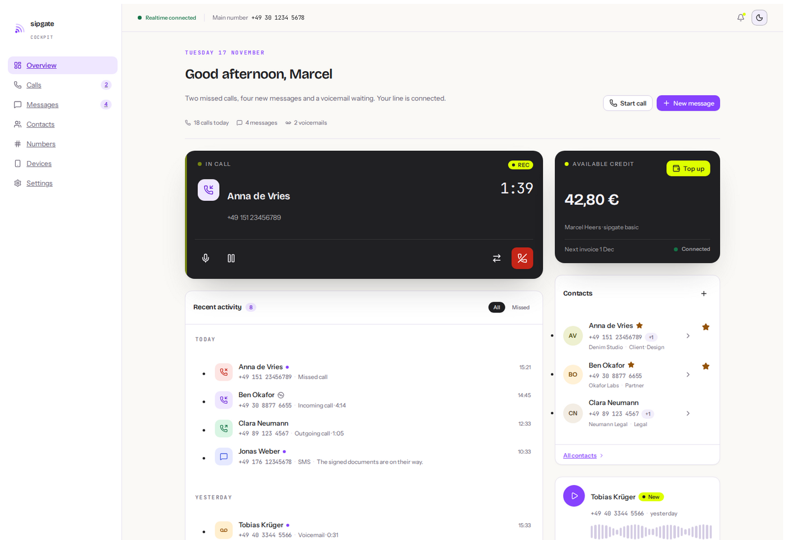

# Cockpit example

A realistic sipgate dashboard built entirely with
[`@mheers/sipgate-ui-components`](../../README.md). It is also the source of the
**Patterns → Cockpit** Storybook story.



## Run it

From the repository root:

```bash
pnpm install
pnpm example:dev
```

Open http://localhost:5173.

## What it demonstrates

- A live `ActiveCallCard` with ticking timer, recording, mute, hold and hangup.
- `CallHistoryList` grouped by day, filtered to missed calls, with a `Dialog` detail view.
- `ContactListItem` favourites that become the SMS recipient.
- `SmsComposer` with recipient validation, live segment counting and send feedback.
- `AccountBalance`, `VoicemailPlayer`, device presence and realtime connection state.
- A theme toggle that flips the same component tree between light and dark.
- A responsive layout: sidebar on desktop, single column on mobile.

## How it consumes the library

The Vite config aliases the package name to the library source, so the example always
reflects the current components:

```ts
resolve: {
  alias: {
    '@mheers/sipgate-ui-components': fileURLToPath(new URL('../../src/index.ts', import.meta.url)),
  },
},
```

`src/demo.css` imports the library stylesheet and adds the source directory as a Tailwind
scan target:

```css
@import '../../../src/styles/index.css';

@source '../../../src';
```

A real application would instead depend on the published package:

```bash
pnpm add @mheers/sipgate-ui-components
```

```ts
import '@mheers/sipgate-ui-components/style.css';
```

The data in the example is fictional and lives in
[`src/storybook/data.ts`](../../src/storybook/data.ts) so Storybook and the example stay in
sync.
